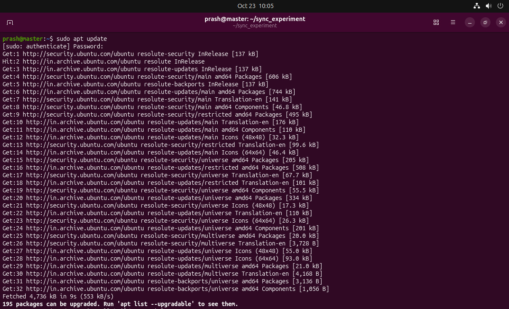
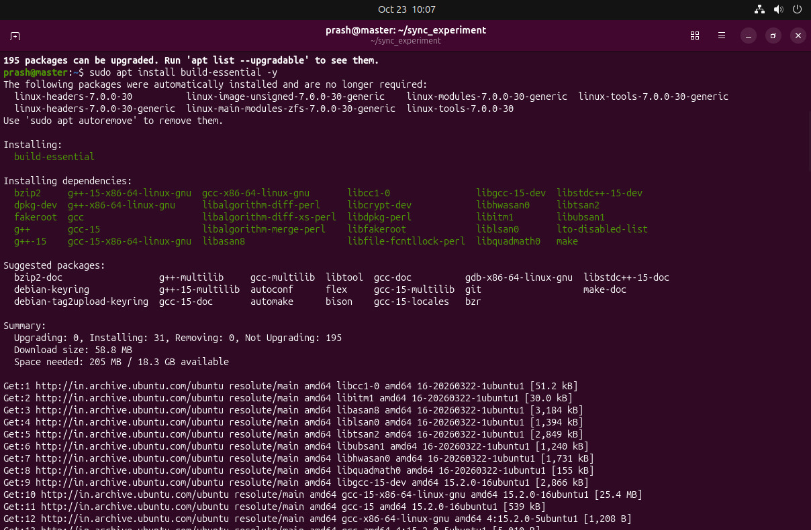
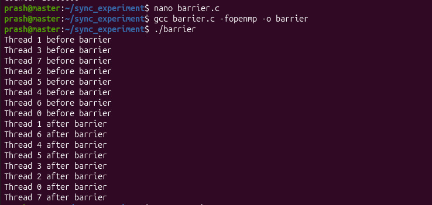
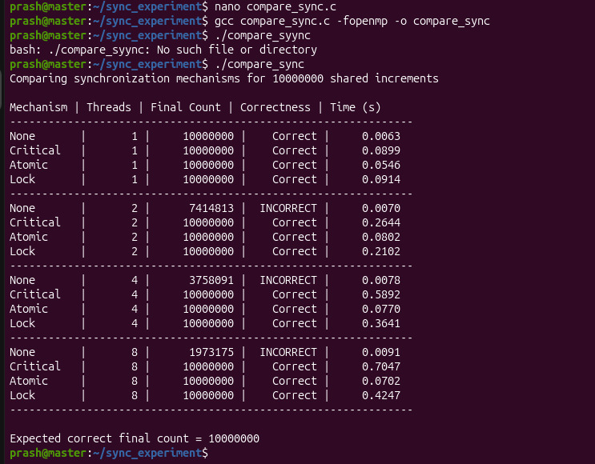

# Synchronization Mechanisms in Parallel Programs

## Aim
To study synchronization mechanisms in parallel programs and observe how they help protect shared data and coordinate threads.

## Objectives
- Demonstrate a race condition when multiple threads update a shared counter without synchronization.
- Protect a shared counter using OpenMP `critical` and `atomic` constructs.
- Observe how an OpenMP barrier coordinates threads.
- Protect shared data using a POSIX semaphore with POSIX threads.
- Compare correctness and execution time for unsynchronized increments, critical sections, atomic operations, and OpenMP locks.

## Environment and Requirements
- Ubuntu Linux (tested in an Ubuntu environment)
- GCC compiler with OpenMP support
- POSIX threads and POSIX semaphores
- Terminal

Install the build tools if needed:

```bash
sudo apt update
sudo apt install build-essential
gcc --version
```

The OpenMP programs use `#include <omp.h>` and require the `-fopenmp` compiler option.
## Step-by-Step Procedure

1. Update Ubuntu package information and install `build-essential`.
2. Verify GCC is available using `gcc --version`.
3. Verify OpenMP support by compiling an OpenMP program with `-fopenmp`.
4. Create the experiment directory and source files.
5. Compile and execute `race.c` to observe the unsynchronized shared-counter update.
6. Compile and execute `critical.c` and `atomic.c` to compare two ways to protect the counter.
7. Compile and execute `barrier.c` to observe thread coordination.
8. Compile and execute `semaphore.c` using the `-pthread` option.
9. Compile and execute `compare_sync.c` to compare the mechanisms at different thread counts.
10. Record the observed outputs and compare correctness and execution time.

Environment setup screenshots:






## Program Descriptions

### 1. `race.c` — Race Condition
A parallel loop performs 10,000,000 increments of a shared counter without protecting the update. Threads can read and write the counter at overlapping times, so some increments can be lost. The final value may be less than 10,000,000 and can vary between runs.

Compile and run:

```bash
gcc -fopenmp src/race.c -o race
./race
```

Screenshot:


### 2. `critical.c` — Critical Section
The `#pragma omp critical` directive allows only one thread at a time to execute the counter increment inside the critical region. This protects the shared counter, though the threads must wait for access.

Compile and run:

```bash
gcc -fopenmp src/critical.c -o critical
./critical
```

Screenshot:


### 3. `atomic.c` — Atomic Operation
The `#pragma omp atomic` directive makes the counter update an atomic operation. It prevents competing threads from losing increments to this shared variable.

Compile and run:

```bash
gcc -fopenmp src/atomic.c -o atomic
./atomic
```

Screenshot:


### 4. `barrier.c` — Barrier Synchronization
The program prints a message before and after `#pragma omp barrier`. Each thread must reach the barrier before any thread can continue beyond it. The order of printed lines can vary because thread scheduling is not fixed.

Compile and run:

```bash
gcc -fopenmp src/barrier.c -o barrier
./barrier
```

Screenshot:


### 5. `semaphore.c` — Semaphore Synchronization
This program creates two POSIX threads. Each thread increments a shared counter 100,000 times. The semaphore is initialized to 1 and used with `sem_wait` and `sem_post` to ensure only one thread at a time updates the counter. The expected final count is 200,000.

Compile and run:

```bash
gcc src/semaphore.c -o semaphore -pthread
./semaphore
```

Screenshot:



### 6. `compare_sync.c` — Performance Comparison
This program compares four approaches over 10,000,000 shared increments:
- **None:** no synchronization; may produce an incorrect result.
- **Critical:** protects the increment with an OpenMP critical region.
- **Atomic:** protects the increment with an OpenMP atomic directive.
- **Lock:** uses an OpenMP lock around each increment.

It tests 1, 2, 4, and 8 threads and prints the final count, correctness, and elapsed time.

Compile and run:

```bash
gcc -O2 -fopenmp src/compare_sync.c -o compare_sync
./compare_sync
```

Screenshot:




## Benchmark Results

The table below is an example of the measured output from one recorded run. Timings depend on the machine, operating system, compiler, and current system load. The unsynchronized `None` results are nondeterministic and are not guaranteed to repeat.

| Mechanism | Threads | Final Count | Correctness | Time (s) |
|---|---:|---:|---|---:|
| None | 1 | 10000000 | Correct in this run | 0.0063 |
| Critical | 1 | 10000000 | Correct | 0.0899 |
| Atomic | 1 | 10000000 | Correct | 0.0546 |
| Lock | 1 | 10000000 | Correct | 0.0914 |
| None | 2 | 7414813 | Incorrect | 0.0070 |
| Critical | 2 | 10000000 | Correct | 0.2644 |
| Atomic | 2 | 10000000 | Correct | 0.0802 |
| Lock | 2 | 10000000 | Correct | 0.2102 |
| None | 4 | 3758091 | Incorrect | 0.0078 |
| Critical | 4 | 10000000 | Correct | 0.5892 |
| Atomic | 4 | 10000000 | Correct | 0.0770 |
| Lock | 4 | 10000000 | Correct | 0.3641 |
| None | 8 | 1973175 | Incorrect | 0.0091 |
| Critical | 8 | 10000000 | Correct | 0.7047 |
| Atomic | 8 | 10000000 | Correct | 0.0702 |
| Lock | 8 | 10000000 | Correct | 0.4247 |

> **Note:** These values are the results supplied for one observed run. Run `./compare_sync` on your own machine to regenerate local measurements. The `None` implementation has a data race in C/OpenMP; its behavior is not guaranteed and should not be treated as a reliable performance baseline.

## Observations
1. The unsynchronized shared counter can lose updates when multiple threads increment it concurrently.
2. The critical region, atomic operation, and lock produced the expected final count in the recorded benchmark.
3. Synchronization adds overhead because threads must coordinate access to shared data.
4. In this recorded run, the atomic implementation was faster than the critical-region and explicit-lock implementations for the tested thread counts.
5. A barrier is a coordination point: no thread can pass it until all participating threads in the parallel region have arrived.

## Conclusion
This experiment demonstrates why synchronization is important in parallel programs. Shared data must be protected when multiple threads update it concurrently. OpenMP critical regions, atomic operations, locks, barriers, and POSIX semaphores serve different synchronization purposes. The benchmark illustrates the trade-off between correctness and execution time, while also showing that measurements depend on the execution environment.

## Repository Structure

```text
Synchronization-Mechanisms-Parallel-Programs/
├── README.md
├── .gitignore
├── src/
│   ├── race.c
│   ├── critical.c
│   ├── atomic.c
│   ├── barrier.c
│   ├── semaphore.c
│   └── compare_sync.c
├── screenshots/
│   ├── 01-environment-setup.png
│   ├── 02-package-installation.png
│   ├── 03-gcc-version.png
│   ├── 04-openmp-verification.png
│   ├── 05-race-condition.png
│   ├── 06-critical-section.png
│   ├── 07-atomic-operation.png
│   ├── 08-barrier-synchronization.png
│   ├── 09-semaphore-synchronization.png
│   ├── 10-benchmark-compilation-and-run.png
│   └── 11-performance-comparison.png
└── results/
    └── benchmark-results.txt
```
