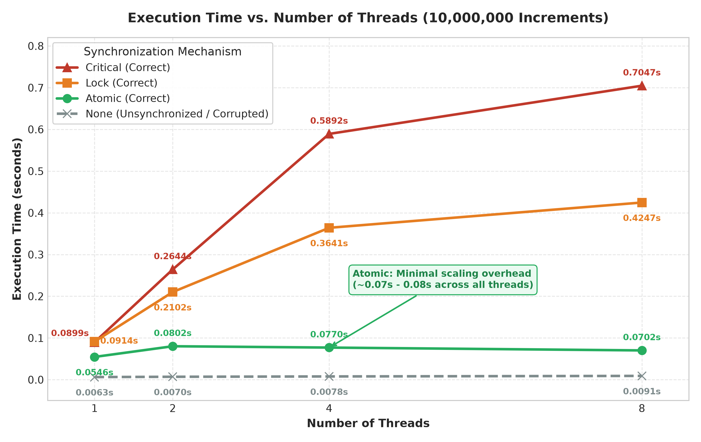
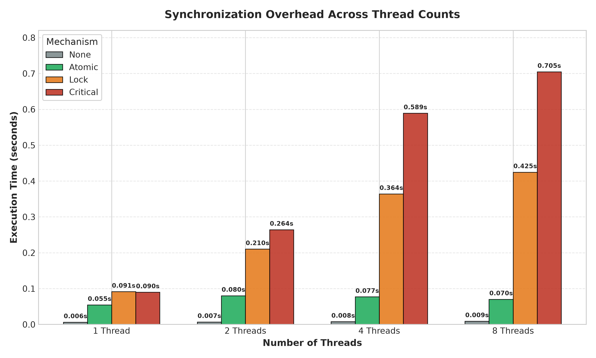
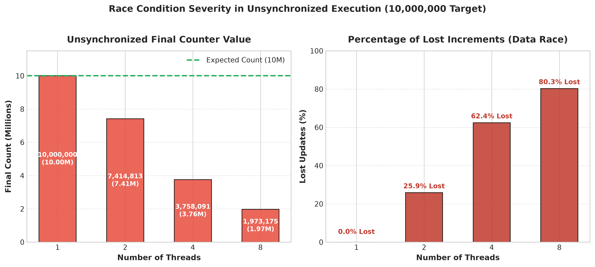

# Synchronization Mechanisms in Parallel Programs

## Aim
To study synchronization mechanisms in parallel programs and observe how they help protect shared data and coordinate threads.

## Objectives
- Demonstrate a race condition when multiple threads update a shared counter without synchronization.
- Protect a shared counter using OpenMP `critical` and `atomic` constructs.
- Observe how an OpenMP barrier coordinates threads.
- Protect shared data using a POSIX semaphore with POSIX threads.
- Compare correctness and execution time for unsynchronized increments, critical sections, atomic operations, and OpenMP locks.

## Environment and Requirements
- Ubuntu Linux (tested in an Ubuntu environment)
- GCC compiler with OpenMP support
- POSIX threads and POSIX semaphores
- Terminal

Install the build tools if needed:

```bash
sudo apt update
sudo apt install build-essential
gcc --version
```

The OpenMP programs use `#include <omp.h>` and require the `-fopenmp` compiler option.
## Step-by-Step Procedure

1. Update Ubuntu package information and install `build-essential`.
2. Verify GCC is available using `gcc --version`.
3. Verify OpenMP support by compiling an OpenMP program with `-fopenmp`.
4. Create the experiment directory and source files.
5. Compile and execute `race.c` to observe the unsynchronized shared-counter update.
6. Compile and execute `critical.c` and `atomic.c` to compare two ways to protect the counter.
7. Compile and execute `barrier.c` to observe thread coordination.
8. Compile and execute `semaphore.c` using the `-pthread` option.
9. Compile and execute `compare_sync.c` to compare the mechanisms at different thread counts.
10. Record the observed outputs and compare correctness and execution time.

Environment setup screenshots:


## Program Descriptions

### 1. `race.c` — Race Condition
A parallel loop performs 10,000,000 increments of a shared counter without protecting the update. Threads can read and write the counter at overlapping times, so some increments can be lost. The final value may be less than 10,000,000 and can vary between runs.

Compile and run:

```bash
gcc -fopenmp src/race.c -o race
./race
```

Screenshot:


### 2. `critical.c` — Critical Section
The `#pragma omp critical` directive allows only one thread at a time to execute the counter increment inside the critical region. This protects the shared counter, though the threads must wait for access.

Compile and run:

```bash
gcc -fopenmp src/critical.c -o critical
./critical
```

Screenshot:


### 3. `atomic.c` — Atomic Operation
The `#pragma omp atomic` directive makes the counter update an atomic operation. It prevents competing threads from losing increments to this shared variable.

Compile and run:

```bash
gcc -fopenmp src/atomic.c -o atomic
./atomic
```

Screenshot:


### 4. `barrier.c` — Barrier Synchronization
The program prints a message before and after `#pragma omp barrier`. Each thread must reach the barrier before any thread can continue beyond it. The order of printed lines can vary because thread scheduling is not fixed.

Compile and run:

```bash
gcc -fopenmp src/barrier.c -o barrier
./barrier
```

Screenshot:


### 5. `semaphore.c` — Semaphore Synchronization
This program creates two POSIX threads. Each thread increments a shared counter 100,000 times. The semaphore is initialized to 1 and used with `sem_wait` and `sem_post` to ensure only one thread at a time updates the counter. The expected final count is 200,000.

Compile and run:

```bash
gcc src/semaphore.c -o semaphore -pthread
./semaphore
```

Screenshot:


### 6. `compare_sync.c` — Performance Comparison
This program compares four approaches over 10,000,000 shared increments:
- **None:** no synchronization; may produce an incorrect result.
- **Critical:** protects the increment with an OpenMP critical region.
- **Atomic:** protects the increment with an OpenMP atomic directive.
- **Lock:** uses an OpenMP lock around each increment.

It tests 1, 2, 4, and 8 threads and prints the final count, correctness, and elapsed time.

Compile and run:

```bash
gcc -O2 -fopenmp src/compare_sync.c -o compare_sync
./compare_sync
```

Screenshot:


## Benchmark Results

The table below summarizes the measured output from the benchmark run recorded in [screenshots/11-performance-comparison.png](screenshots/11-performance-comparison.png). Timings depend on the hardware architecture, operating system, and current system load. The unsynchronized `None` updates suffer from nondeterministic data races.

Raw dataset available at: [`results/benchmark-results.csv`](results/benchmark-results.csv) (and [`results/benchmark-results.txt`](results/benchmark-results.txt))

| Mechanism | Threads | Final Count | Correctness | Time (s) | Relative Overhead vs. Atomic |
|---|---:|---:|---|---:|---:|
| **None** | 1 | 10,000,000 | Correct (No concurrency) | 0.0063 | 0.12x |
| **Critical** | 1 | 10,000,000 | Correct | 0.0899 | 1.65x |
| **Atomic** | 1 | 10,000,000 | Correct | 0.0546 | 1.00x (Baseline) |
| **Lock** | 1 | 10,000,000 | Correct | 0.0914 | 1.67x |
| **None** | 2 | 7,414,813 | **Incorrect** (25.9% lost) | 0.0070 | 0.09x |
| **Critical** | 2 | 10,000,000 | Correct | 0.2644 | 3.30x |
| **Atomic** | 2 | 10,000,000 | Correct | 0.0802 | 1.00x (Baseline) |
| **Lock** | 2 | 10,000,000 | Correct | 0.2102 | 2.62x |
| **None** | 4 | 3,758,091 | **Incorrect** (62.4% lost) | 0.0078 | 0.10x |
| **Critical** | 4 | 10,000,000 | Correct | 0.5892 | 7.65x |
| **Atomic** | 4 | 10,000,000 | Correct | 0.0770 | 1.00x (Baseline) |
| **Lock** | 4 | 10,000,000 | Correct | 0.3641 | 4.73x |
| **None** | 8 | 1,973,175 | **Incorrect** (80.3% lost) | 0.0091 | 0.13x |
| **Critical** | 8 | 10,000,000 | Correct | 0.7047 | 10.04x |
| **Atomic** | 8 | 10,000,000 | Correct | 0.0702 | 1.00x (Baseline) |
| **Lock** | 8 | 10,000,000 | Correct | 0.4247 | 6.05x |

> **Note:** Run `./compare_sync` on your own machine to regenerate local measurements. The `None` implementation has an intentional data race in C/OpenMP; its behavior is undefined and produces incorrect results under concurrency.

---

## Graphical Performance Analysis


### 1. Execution Time vs. Number of Threads
This plot illustrates how each synchronization mechanism scales as the thread count increases from 1 to 8 threads (10,000,000 shared counter increments):



**Key Insights:**
- **Atomic Operation (`#pragma omp atomic`) — Superior Scalability:** Execution time remains nearly flat across all thread counts (`0.0546s` at 1 thread, `0.0802s` at 2 threads, `0.0770s` at 4 threads, and `0.0702s` at 8 threads). Because atomic operations are directly translated to hardware atomic primitives (e.g., `LOCK XADD` on x86/x64), threads do not enter software sleep or experience heavy OS lock contention.
- **Critical Section (`#pragma omp critical`) — Severe Serialization Bottleneck:** Execution time grows steeply from `0.0899s` with 1 thread to `0.7047s` with 8 threads (a **7.8x increase**). OpenMP critical sections enforce global mutual exclusion across threads, leading to high contention, frequent thread idling, and serialization.
- **OpenMP Lock (`omp_lock_t`) — Moderate Overhead:** Shows an intermediate scaling profile, climbing from `0.0914s` to `0.4247s` (a **4.6x increase**). While faster than `critical` due to lighter compiler-level lock mechanics, it still incurs significant lock-acquisition wait times at higher thread counts.
- **Unsynchronized (`None`) — Misleadingly Fast:** Remains below `0.010s` because threads run freely with zero synchronization overhead, but results in critical data corruption.

---

### 2. Synchronization Overhead Comparison
A direct side-by-side grouped bar chart comparing execution times across 1, 2, 4, and 8 threads:



**Key Insights:**
- At **1 Thread**, overhead between `Critical` (`0.0899s`) and `Lock` (`0.0914s`) is nearly identical, while `Atomic` is ~39% faster (`0.0546s`).
- At **8 Threads**, `Critical` (`0.7047s`) is **10x slower** than `Atomic` (`0.0702s`), and `Lock` (`0.4247s`) is **6x slower** than `Atomic`.

---

### 3. Race Condition & Data Loss Severity
Analysis of lost increments in the unsynchronized shared counter (`expected = 10,000,000`):



| Threads | Expected Count | Actual Final Count | Lost Increments | Data Loss (%) | Correctness |
|:---:|:---:|:---:|:---:|:---:|:---:|
| **1** | 10,000,000 | 10,000,000 | 0 | **0.0%** | Correct |
| **2** | 10,000,000 | 7,414,813 | 2,585,187 | **25.9%** | Incorrect |
| **4** | 10,000,000 | 3,758,091 | 6,241,909 | **62.4%** | Incorrect |
| **8** | 10,000,000 | 1,973,175 | 8,026,825 | **80.3%** | Incorrect |

**Key Insights:**
- With 1 thread, no concurrency exists, so all 10,000,000 updates succeed.
- As concurrency increases, thread interleaving on unsynchronized read-modify-write operations (`counter++`) causes massive update overwrite.
- At 8 threads, **over 80.2% of all updates are lost**, resulting in a final count of only 1,973,175 instead of 10,000,000.

---


---

## Observations
1. **Race Conditions Cause Severe Data Loss:** The unsynchronized shared counter loses updates when multiple threads increment it concurrently, reaching over 80% data corruption at 8 threads.
2. **Synchronization Guarantees Correctness:** OpenMP `atomic`, `critical`, and OpenMP locks all guarantee 100% correct final counts (10,000,000 / 10,000,000).
3. **Atomic Primitives Are Most Efficient:** For simple scalar updates, `#pragma omp atomic` is vastly superior in both speed and scalability compared to coarse-grained `critical` sections or locks (up to 10x faster at 8 threads).
4. **Critical Section Serialization Penalty:** Critical sections enforce total mutual exclusion, causing heavy lock contention and thread stalling as the number of threads increases.
5. **Barriers Synchronize Execution Phases:** `#pragma omp barrier` ensures all threads reach a synchronization point before proceeding, preventing execution order skew.

## Conclusion
This experiment demonstrates why synchronization is vital in parallel programming. Unsynchronized shared state inevitably leads to race conditions and severe data corruption. OpenMP provides multiple synchronization tools suited for different granularities:
- Use **`atomic`** for single memory updates (counters, accumulations) where hardware acceleration delivers near-zero scaling overhead.
- Use **`critical`** or **locks** when multiple operations or code blocks need atomic execution as a unit.
- Use **`barrier`** and **semaphores** for thread coordination and resource signaling.

---

## Repository Structure

```text
Synchronization_Mechanism/
├── README.md
├── .gitignore
├── src/
│   ├── race.c
│   ├── critical.c
│   ├── atomic.c
│   ├── barrier.c
│   ├── semaphore.c
│   └── compare_sync.c
├── screenshots/
│   ├── 01-environment-setup.png
│   ├── 02-package-installation.png
│   ├── 03-gcc-version.png
│   ├── 04-openmp-verification.png
│   ├── 05-race-condition.png
│   ├── 06-critical-section.png
│   ├── 07-atomic-operation.png
│   ├── 08-barrier-synchronization.png
│   ├── 09-semaphore-synchronization.png
│   ├── 10-benchmark-compilation-and-run.png
│   └── 11-performance-comparison.png
└── results/
    ├── benchmark-results.csv
    ├── benchmark-results.txt
    ├── generate_graphs.py
    ├── benchmark_summary.png
    ├── execution_time_comparison.png
    ├── synchronization_overhead_comparison.png
    └── race_condition_loss.png
```

